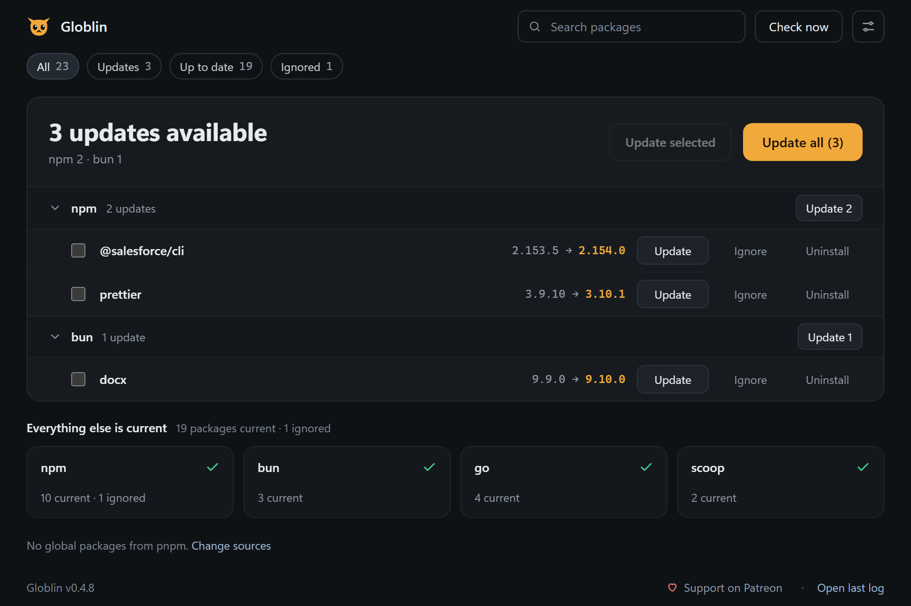
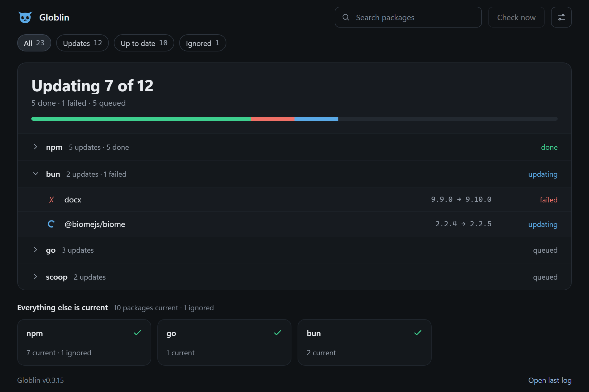
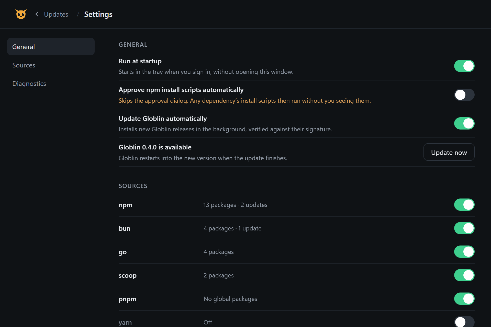

<div align="center">
  

  # Globlin

  A tray icon that watches your global packages — npm, bun, pnpm, yarn, pipx, uv, scoop, cargo, go,
  dotnet, PowerShell Gallery, gem, Homebrew, winget, choco — and tells you when one falls behind.

  [](https://github.com/TOR968/Globlin/actions/workflows/ci.yml)
  [](https://github.com/TOR968/Globlin/releases/latest)

  [**globlin.pages.dev**](https://globlin.pages.dev)
</div>

> **Beta.** Globlin is still in beta on every platform: the Windows builds are in daily use, the installer
> and the ARM64 builds are new, and the macOS and Linux builds are experimental. Please
> [open an issue](https://github.com/TOR968/Globlin/issues) when something misbehaves.

**[Install](#install)** · **[Using it](#using-it)** · **[Sources](#sources)** ·
**[Icon states](#icon-states)** · **[Keeping itself updated](#keeping-itself-updated)** ·
**[More](#more)** · **[License](#license)**

## What it does

Global CLIs rot silently — nothing tells you `@salesforce/cli` is six versions behind until a command
breaks in a way that turns out to be "oh, I'm ancient." Globlin sits in the tray, checks on a schedule,
and shows you exactly what's behind, across every package manager you have installed. Open the window to
see the lot in one list, filter it by status or by source, tick the ones you want and update them in a
batch. It never touches anything on its own unless you turn that on.

On Windows it is one ~3.3 MB `.exe` with no runtime dependencies — run it portable, or let the
per-user installer put it in place. The window is drawn by WebView2, which ships with Windows 11 and with
any up-to-date Windows 10. Experimental builds exist for macOS (Apple Silicon) and Linux (deb, rpm, AUR, AppImage).

## Install

Every [release](https://github.com/TOR968/Globlin/releases/latest) comes two ways, each for x64 and for
Windows on ARM (Snapdragon and other ARM64 laptops):

- **Installer** — `globlin-setup-x64.exe` or `globlin-setup-arm64.exe`. Installs for your user only, no
  administrator prompt, into `%LOCALAPPDATA%\Programs\Globlin`; adds a Start menu entry, an entry in
  *Settings → Apps* to uninstall it from, and optionally a desktop shortcut and *Run when I sign in*.
- **Portable** — `globlin.exe` or `globlin-arm64.exe`. Run it; nothing to install, nothing to unzip. It
  keeps its config next to itself, so you can move the `.exe` anywhere and it keeps working.

Both update themselves the same way. Right-click the tray icon and tick **Run at startup** if you want it
running every time you log in.

### macOS (experimental)

Apple Silicon (M1 and later), macOS 11 or newer. The app is signed ad hoc, not notarised, so macOS asks
you to allow it once:

1. Download **`globlin-macos-apple-silicon.zip`**.
2. Unzip it and drag **Globlin.app** into *Applications*.
3. Open Globlin.app. macOS answers *"Globlin" Not Opened — Apple could not verify…*; choose **Done**, not
   *Move to Trash*.
4. Open *System Settings → Privacy & Security*, scroll to the bottom and choose **Open Anyway** next to
   Globlin, then confirm. The button only shows for about an hour after the blocked launch. If it is not
   there, run this once in Terminal and open the app again:

   ```sh
   xattr -dr com.apple.quarantine /Applications/Globlin.app
   ```

5. Globlin now sits in the menu bar at the top right. While its window is open it also shows in the
   Dock and in ⌘-Tab; closing the window sends it back to the menu bar only.
6. Optional: allow its notifications under *System Settings → Notifications → Globlin*, and tick **Run at
   startup** in the window's Settings or the menu.

After that it updates itself like the Windows builds — no need to repeat the steps. Its settings and logs
are in `~/Library/Application Support/globlin/`; *Run at startup* writes
`~/Library/LaunchAgents/dev.globlin.app.plist`. Homebrew packages are compared with your local taps, so run
`brew update` now and then. It is new and tested on one Mac so far — please
[open an issue](https://github.com/TOR968/Globlin/issues) when something misbehaves.

### Linux (experimental)

A `.deb` for Debian and Ubuntu (`globlin-amd64.deb`, `globlin-arm64.deb`) and an `.rpm` for Fedora,
openSUSE and friends (`globlin-x86_64.rpm`, `globlin-aarch64.rpm`):

```sh
sudo apt install ./globlin-amd64.deb      # Debian 12+, Ubuntu 22.04+
sudo dnf install ./globlin-x86_64.rpm     # Fedora
yay -S globlin-bin                        # Arch, from the AUR
```

Or take the AppImage (`globlin-x86_64.AppImage`, `globlin-aarch64.AppImage`) — one file for any
distribution, and the only Linux build that updates itself:

```sh
mkdir -p ~/Applications && cd ~/Applications
curl -LO https://github.com/TOR968/Globlin/releases/latest/download/globlin-x86_64.AppImage
chmod +x globlin-x86_64.AppImage && ./globlin-x86_64.AppImage
```

It is a thin AppImage: it carries Globlin, its desktop file and its icons, and uses the WebKitGTK 4.1, GTK 3
and Ayatana AppIndicator libraries already on the system (`webkit2gtk-4.1` and `libayatana-appindicator`
on Arch). Keep it in a folder you can write to — an update replaces the file in place.

Until `globlin-bin` is published in the AUR, every release also carries the same PKGBUILD with its version
and checksums filled in:

```sh
curl -L -o PKGBUILD https://github.com/TOR968/Globlin/releases/latest/download/globlin-bin.PKGBUILD
makepkg -si
```

The package pulls in WebKitGTK 4.1 and the Ayatana AppIndicator library. GNOME shows tray icons only with
the *AppIndicator and KStatusNotifierItem Support* extension; KDE, Xfce, Cinnamon and most other desktops
show them out of the box. On Linux the tray icon opens its menu on any click — pick **Open Globlin** for
the window. A packaged Globlin does not update itself: install the new package from the release page.
The AppImage does, like the Windows and macOS builds.
Settings and logs live in `~/.local/share/globlin/`; *Run at startup* writes
`~/.config/autostart/globlin.desktop`.

<details>
<summary><strong>If Windows Defender flags the download</strong> —
what it was, and what fixed it</summary>

<br>

Releases up to v0.2.7 were flagged by a few engines, and Defender quarantined the download as
`Trojan:Win32/Wacatac.B!ml`. The `!ml` suffix is the tell: no signature matched, a machine-learning model
guessed.

**The cause was not what Globlin does.** A scanner never runs the file — it reads its shape. The release
profile was tuned for a small binary, which produced 1.7 MB of unusually dense code, and small dense
executables are what packed malware looks like. Nothing here was packed, compressed or hidden; it merely
resembled something that is.

Building with a conventional profile settled it: that took the binary from 1.7 MB to 2.8 MB, and three of
the four engines stopped objecting. The identical source, built the size-tuned way, still draws them —
that comparison and its numbers are in
[`docs/DEVELOPMENT.md`](docs/DEVELOPMENT.md#the-release-profile-is-an-antivirus-decision). It has grown
since — the package-list window links WebView2's glue in — and ships at about 3.3 MB today, which moves
it further from the shape that was flagged, not closer.

Microsoft flags some builds and not others, because an unsigned binary of this shape sits close to the
model's line. The installers are a separate case: every release, three or four machine-learning engines
(Arctic Wolf, DeepInstinct, SecureAge, Skyhigh) flag `globlin-setup-*.exe` while the portable `.exe`
beside it scans clean. They object to the unsigned Inno Setup wrapper — a program that unpacks and
starts another program — not to Globlin; an installer built without compression drew the same verdicts.
If yours objects:

1. **Update your definitions** from an elevated PowerShell and rescan. Microsoft has reviewed Globlin
   before and removed the detection on request.

   ```powershell
   Update-MpSignature
   ```

2. **Check the hash and the signature.** Every release publishes `SHA256SUMS`, the SHA-256 of every
   file in it, and `SHA256SUMS.minisig`, a [minisign](https://jedisct1.github.io/minisign/) signature
   of that list by the Globlin release key. Run `Get-FileHash` on your download and find the same hash
   in `SHA256SUMS` — a match means nothing altered the download. The signature proves the list came
   from this project's release pipeline:
   `minisign -Vm SHA256SUMS -P RWTTLQhyI4Bn/MclkJqsthxavfiFPGVos6b7/d9keFthKYcrAmvZ31V+`. The release
   notes open with the exact commands.
3. **Read the VirusTotal report** linked from that release's notes. CI uploads every build as it is
   published, so you get the full engine spread rather than one engine's guess.
4. **Build it yourself** — see *Building from source* below. The source is all here and
   `cargo build --release` is the whole of it.

</details>

## Using it

Starting Globlin yourself — from the Start menu, a pinned icon or the `.exe` — opens the window, or
brings it forward when Globlin is already running; started by *Run at startup* it stays quietly in the
tray. After that, click the tray icon or one of its notifications, or pick **Open Globlin** from the
right-click menu:



The window puts updates first:

- **The hero card** says what needs doing — *3 updates available*, and which sources they come from —
  with **Update all (N)** beside it. Under it the outdated packages are grouped by source; each group
  collapses, has its own **Update N** button, and shows five rows until you ask for the rest with
  **Show N more**. Tick rows and **Update selected** runs just those, as one queue.
- **Everything else** sits below as one tile per source with its count — *11 current*, *2 current ·
  1 ignored*. Click a tile to open that source's full list. The heading only says *Everything else is
  current* when it is: a package the registry hasn't answered for shows `?` and is counted as *not
  checked*, never as fine. A package installed from a git URL, a local folder, `npm link` or a private
  registry also shows `?`: Globlin never compares it with the public registry, so a public package with
  the same name can never be offered as its update.
- **Search** narrows every list as you type, and the chips above the card — *All*, *Updates*, *Up to
  date*, *Not checked*, *Ignored* — filter by status. While either is active, every source with a match
  opens on its own.
- Per row: **Update** runs `npm install -g <name>@latest` (or the pnpm/yarn/bun equivalent) with no
  console window, then re-checks. **Ignore** removes it from checks and from `Update all` without
  touching the network — **Unignore** and it's re-checked immediately. **Uninstall** arms into a
  **Confirm** button and then removes the package with `npm uninstall -g <name>` (or the equivalent). The
  two clicks are the confirmation; there is no dialog.



- **While a queue runs** the hero card turns into its progress: *Updating 7 of 12*, a bar split into
  done, failed and running, and the queue grouped by source. The group that is running opens by itself,
  so does one with a failure, and the rest fold to one line saying *done* or *queued*.
- If npm 12 refuses an update because a dependency wants to run install scripts you have not approved,
  Globlin opens its window with the list of packages and the exact scripts. **Allow and update** adds
  those exact versions to `allow-scripts` in your user `.npmrc` and runs the update again; **Not now**
  leaves the old version in place. **Approve npm install scripts automatically**, in Settings, skips the
  dialog and allows them straight away. It is off by default, because with it on any dependency's
  install scripts run without you seeing them. If the retry is refused again, the dialog opens as usual.
- **winget and choco rows are read-only.** Both need an elevated process to upgrade anything, and Globlin
  runs unelevated, so it reports them and leaves the doing to you. Their rows say `read-only`, can't be
  ticked, and never join a queue.
- A desktop notification only fires when the set of outdated packages *changes*, so it won't nag about
  the same three packages every six hours.



**Settings**, behind the button at the top right, holds the rest: *Run at startup*, *Monochrome tray icon*, *Approve npm install
scripts automatically*, *Update Globlin automatically* (greyed out with the manager's name when winget
or the installer keeps Globlin up to date) and, when a release is waiting, **Update now**. Under
*Sources* every package manager this platform can have gets a switch and a one-line status — *13
packages · 2 updates*, *No global packages*, *Off*. Switching one goes into `globlin.json` and triggers a
fresh check. *Diagnostics* opens the last log; *About* shows the version and links to
[Patreon](https://www.patreon.com/c/TOR968), as does *Support on Patreon* beside *Open last log* at the
foot of the window.

The tray menu stays short — the list lives in the window:

```
Globlin — 3 updates available
─────────────────────────────────────
Open Globlin
Update all (2)
Check now
☑ Run at startup
Open last log
─────────────────────────────────────
Globlin v0.4.0                        ▸  Update Globlin 0.4.0 → 0.4.1
                                         ☐ Auto-update Globlin
                                         Open Globlin-update log
Support Globlin on Patreon
─────────────────────────────────────
Quit
```

`Update all (2)` counts what Globlin can actually update — the third, a winget package, is reported but
not actionable. While a batch runs, the menu also shows up to seven rows around the package being
updated and one `… N more` line; the full queue is in the window.

## Sources

| Source | Where the list comes from | Where `latest` comes from | Update |
|---|---|---|---|
| **npm** | `npm ls -g --json --depth=0` | registry.npmjs.org | `npm install -g <name>@latest` |
| **bun** | the global `package.json` + `node_modules` | registry.npmjs.org | `bun add -g <name>@latest` |
| **pnpm** | `pnpm ls -g --json --depth=0` | registry.npmjs.org | `pnpm add -g <name>@latest` |
| **yarn** | `yarn global dir` + `node_modules` | registry.npmjs.org | `yarn global add <name>@latest` |
| **pipx** | `pipx list --short` | the project's PyPI release feed | `pipx upgrade <name>` |
| **uv** | `uv tool list` | `uv tool list --outdated` | `uv tool upgrade <name>` |
| **scoop** | `apps\*\current\manifest.json` | the manifest in the app's local bucket | `scoop update <name>` |
| **cargo** | `cargo install --list` | crates.io, one request for every crate | `cargo install <name>` |
| **go** | `go version -m` over the Go bin directory | `go list -m <module>@latest` | `go install <package>@latest` |
| **dotnet** | `dotnet tool list --global` | the NuGet flat-container index | `dotnet tool update --global <name>` |
| **psgallery** | `Get-InstalledModule` | the PowerShell Gallery's package redirect | `Update-Module -Scope CurrentUser` |
| **gem** | `gem list --local` | `gem outdated` | `gem update <name>` |
| **brew** | `brew info --json=v2 --installed` (formulae and casks) | the same reply — brew's `outdated` flag | `brew upgrade <name>` |
| **winget** | `winget list` | winget's own `Available` column | read-only |
| **choco** | `choco list -r` + `choco outdated -r` | choco's own report | read-only |

Everything except psgallery, winget and choco is on by default. A source whose CLI isn't installed simply
reports nothing — it is not an error, not even when none of them is installed, and one broken source never
sinks the others. psgallery is off
because it has to start PowerShell on every check, which costs about a second; winget and choco are off
because both are slower to list and neither can be updated from an unelevated app. Turn any of them on
from the window's Settings, or in `globlin.json`.

**yarn means yarn classic (v1).** Yarn 2+ removed `yarn global` entirely; on a Berry install the source
reports zero packages and says so in the log.

**pipx and uv, not pip.** `pip list` reports every library in whichever interpreter happens to be first
on `PATH` — mostly transitive dependencies, and often not the environment your shell is in. pipx and
`uv tool` give each CLI its own venv, so their listings name exactly the tools you installed globally, and
neither needs elevation to upgrade one. A PyPI, NuGet or Gallery version that is not a plain run of
numbers (`1.0.0rc1`, `1.0.0.post1`) is reported as not checked rather than guessed at.

**scoop is compared against your local buckets.** Globlin reads the same bucket manifests `scoop status`
reads and never runs `scoop update` for you, so an app is only as current as your last bucket refresh.
Apps installed with `scoop install -g` live under `C:\ProgramData\scoop` and are not listed.

**brew is compared against your local taps**, like scoop against its buckets: Globlin never runs
`brew update`, so a formula is only as current as your last `brew update` (which brew runs on its own
before most installs). Both formulae and casks are listed.

**cargo and go build from source.** Their **Update** runs a real compile, which can take minutes; the row
keeps spinning until it finishes. Go has no uninstall command, so **Uninstall** on a go
row deletes the binary from your Go bin directory itself, after finding it with `go version -m`, and refuses
to touch anything outside that directory.

The same package can be installed under several managers and stays distinguishable: the window shows the
source in its own column, and menu and notification text suffix it — `typescript (pnpm)`.

## Icon states

The tray icon is drawn from code, not an image file, so its colour always matches what it's telling you:

| | State | Meaning |
|---|---|---|
|  | **Idle** — emerald | everything installed is current |
|  | **Updates** — amber | one or more packages are behind |
|  | **Error** — red | the last check failed, a source could not be listed, or a registry could not be reached (the notification and *Open last log* name it) |
|  | **Busy** — sky blue | a check or an update is running, filling like a glass |

If the coloured goblin stands out too much next to the system icons, switch on **Monochrome tray icon** in
the window's Settings. The goblin is then drawn in one colour with its face cut out — white on a dark
taskbar, near-black on a light one, and on macOS a template image the menu bar tints itself. Colour can't
carry the state any more, so a dot beside the head means updates are waiting, a dot with an exclamation
mark means something went wrong, and while a job runs the dim outline fills solid from the bottom up.

## Keeping itself updated

> **Upgrading from 0.3.x:** 0.4.0 changed how updates are signed and named, so a 0.3.x build cannot
> update itself to it. Install 0.4.0 by hand once — from then on it keeps itself updated as below.

Globlin also checks its own [GitHub releases](https://github.com/TOR968/Globlin/releases) on the same
schedule as the package check. The `Globlin v<current>` submenu names the build that is running, so you
can always tell which one is live. When a newer one is published the submenu grows an
`Update Globlin <current> → <new>` row; ticking **Auto-update Globlin** (or **Update Globlin
automatically** in the window's Settings) installs it unattended the next time one is found, no click
needed.

Before installing anything, the download must carry a valid signature by the Globlin release key, whose
public half is built into the app, and match its published SHA-256 checksum — a release without a
signature is not offered, a mismatch is discarded, and the running app is never touched. The one real failure mode: if Globlin can't write next
to itself (installed under `Program Files` without elevation, or a directory an antivirus is holding
open), the install fails. You get one toast about it, not a repeat nag; auto-update stops retrying that
build rather than re-downloading it every few hours, and the reason lands in a log you can open from the
menu. The row stays, so you can still retry by hand. See
[`docs/DEVELOPMENT.md`](docs/DEVELOPMENT.md#self-update-mechanics) for exactly how the swap, rollback and
restart work.

## More

<details>
<summary><strong>Configuration</strong> — <code>globlin.json</code></summary>

<br>

The portable Windows build reads it from next to the exe first, otherwise from
`%LOCALAPPDATA%\globlin\`, and writes it back to whichever of those accepts a write. An installed build
(the installer or winget) and every macOS and Linux build keep it in the data directory only —
`%LOCALAPPDATA%\globlin\`, `~/Library/Application Support/globlin/` or `~/.local/share/globlin/`. Missing keys take their defaults, so a partial file is fine. If the file isn't
valid JSON, it's moved to `globlin.json.invalid`, defaults are used, and a notification says so — your
edits are never silently overwritten.

```json
{
  "check_interval_hours": 6,
  "sources": {
    "npm": true,
    "bun": true,
    "pnpm": true,
    "yarn": true,
    "pipx": true,
    "uv": true,
    "scoop": true,
    "cargo": true,
    "go": true,
    "dotnet": true,
    "psgallery": false,
    "gem": true,
    "brew": true,
    "winget": false,
    "choco": false
  },
  "ignore": ["npm", "@anthropic-ai/claude-code"],
  "last_notified": [],
  "npm_cmd": null,
  "auto_update": false,
  "auto_approve_scripts": false,
  "monochrome_icon": false,
  "last_self_notice": null
}
```

- **`sources`** — which package managers to check. Missing keys take their defaults, so an older config
  file keeps working and simply gains the new sources. See [Sources](#sources).
- **`ignore`** — listed packages still appear in the window with their version, but are never checked,
  flagged or notified about. `npm` is ignored by default because updating it on Windows means it rewrites
  its own shim mid-run; `@anthropic-ai/claude-code` because it self-updates. An explicit `[]` is respected.
- **`last_notified`** — bookkeeping for the "only notify on change" rule. Clear it to force the next
  check to notify again.
- **`npm_cmd`** — an override, only needed if `npm.cmd` is somewhere unusual. Left `null`, `PATH` is
  searched, then `%APPDATA%\npm\npm.cmd`. The file must be called `npm` (`npm.cmd`, `npm.exe`) and
  must not be a downloaded file still carrying Windows' *from the internet* mark; otherwise npm is
  skipped rather than run.
- **`auto_update`** — see [Keeping itself updated](#keeping-itself-updated).
- **`auto_approve_scripts`** — the **Approve npm install scripts automatically** switch in the window's
  Settings; see [Using it](#using-it).
- **`monochrome_icon`** — the **Monochrome tray icon** switch in the window's Settings; see
  [Icon states](#icon-states).
- **`last_self_notice`** — the version string of the last self-update failure a toast was already raised
  for, so retrying the same failing version doesn't notify twice.

</details>

<details>
<summary><strong>Diagnostics &amp; removing it</strong></summary>

<br>

In `%LOCALAPPDATA%\globlin\`: **`last-check.txt`** (every package from the most recent check with its
state — look here first when the window shows something surprising), **`last-run.log`** (stdout/stderr of
the failed package updates of the most recent batch, written as soon as each one fails, and the reason a
source could not be listed, reachable from *Open last log*), **`self-update.log`** (the
error from the most recent *failed* self-update lookup, kept separate so an offline run doesn't overwrite
the log *Open last log* reads), and **`app.ico`** (the notification artwork).

To remove an installed Globlin, uninstall it from *Settings → Apps*; that also removes the *Run at
startup* entry, and leaves `%LOCALAPPDATA%\globlin\` (settings and logs) for a reinstall — delete it if
you are done for good. To remove the portable one: quit from the tray menu, delete the `.exe` and its
`.json`, then delete
`%LOCALAPPDATA%\globlin\`. If a self-update was interrupted, `globlin.exe.old` may still be sitting next
to the `.exe` — safe to delete too. Two optional `HKEY_CURRENT_USER` cleanups:

- `Software\Microsoft\Windows\CurrentVersion\Run` → `globlin`, only if *Run at startup* was ever enabled.
- `Software\Classes\AppUserModelId\Globlin.Tray`, created so notifications are attributed to "Globlin"
  rather than to PowerShell.

Nothing else is written — no service, no scheduled task. The installer adds only its own uninstall
entry and shortcuts, and removes them again.

**Upgrading from `npm-globals-tray`:** this app was renamed from `npm-globals-tray` to Globlin. The new
build starts fresh with default settings, leaving three harmless leftovers you can delete once you've
switched to `globlin.exe`: the old config file (`npm-globals-tray.json`), the old data directory
(`%LOCALAPPDATA%\npm-globals-tray\`), and the old `Run` key value named `npm-globals-tray`.

</details>

<details>
<summary><strong>Building from source</strong></summary>

<br>

On Windows, a Rust toolchain (MSVC) plus Microsoft C++ Build Tools and the Windows SDK. On macOS, a Rust
toolchain and the Xcode command-line tools. On Debian or Ubuntu, a Rust toolchain plus
`libgtk-3-dev libayatana-appindicator3-dev libwebkit2gtk-4.1-dev`.

```
cargo build --release
```

On Windows `target/release/globlin.exe` is portable — copy it anywhere and run it; it keeps its config
next to itself. The macOS `.app` bundle and the Linux packages are assembled by the scripts in `.github/`
— see [`docs/DEVELOPMENT.md`](docs/DEVELOPMENT.md#other-platforms).

</details>

For architecture notes, the verified environment workarounds, tests, lints, and the CI/release pipeline,
see [`docs/DEVELOPMENT.md`](docs/DEVELOPMENT.md).

## Code signing policy

The Windows builds are not code-signed, so SmartScreen warns the first time one runs. Free signing through
[SignPath Foundation](https://signpath.org) was applied for in October 2026 and declined for now: the
Foundation signs projects that already have wider public adoption, and Globlin will apply again once it
does. Until then, what is signed is the release itself — every file is listed in `SHA256SUMS`, and that
list is signed with the Globlin [minisign](https://jedisct1.github.io/minisign/) release key, the same key
the app checks before it updates itself (see *If Windows Defender flags the download* above).

- **What is released:** only the files `.github/workflows/release.yml` builds from a tagged commit of this
  repository on GitHub-hosted runners. Nothing built anywhere else, and no third-party binaries.
- **Team roles:** committers, reviewers and release approvers — [TOR968](https://github.com/TOR968).
  Every release is reviewed and merged by hand.
- **Multi-factor authentication** is required on GitHub for every role.
- **Uninstalling:** the installer registers an uninstaller under *Settings → Apps*; the portable build
  and everything Globlin writes are covered in *Diagnostics & removing it* above.

### Privacy

Globlin has no telemetry, no analytics, no crash reports and no account, and sends no identifier of any kind. It
goes on the network only to do what it is for, and every request it makes names Globlin in its user agent:

- **Version lookups:** the names of your installed packages are sent to the public registry of their
  package manager — `registry.npmjs.org` (npm, bun, pnpm, yarn), `pypi.org` (pipx), `crates.io` (cargo),
  `api.nuget.org` (dotnet) and `www.powershellgallery.com` (PowerShell Gallery). Switching a source off in
  Settings stops its lookups, and ignored packages are never looked up. An npm, bun, pnpm or yarn package
  installed from git, a local path, a link or a private registry is never sent to the public registry.
- **Its own updates:** `api.github.com` is asked for the latest Globlin release, and an update is
  downloaded from GitHub's release storage. Builds owned by winget or a system package manager skip this.
- **The package managers themselves** contact their own servers when Globlin runs their list, outdated,
  update and uninstall commands; what they send is governed by their own privacy policies.

## License

Copyright (C) 2026 TOR968.

Globlin is free software: you can redistribute it and/or modify it under the terms of the GNU General
Public License as published by the Free Software Foundation, either version 3 of the License, or (at your
option) any later version.

It is distributed in the hope that it will be useful, but WITHOUT ANY WARRANTY — without even the implied
warranty of MERCHANTABILITY or FITNESS FOR A PARTICULAR PURPOSE. See the [GNU General Public
License](LICENSE) for details, or <https://www.gnu.org/licenses/>.
